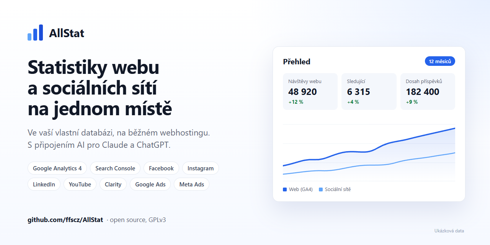

# AllStat

[English](README.md) | **Čeština**

Unifikovaný analytický dashboard: na jednom místě sbírá statistiky webu a sociálních sítí
a ukládá je do **vaší vlastní databáze**. Běží na běžném webhostingu s PHP a MySQL.

**Návod k instalaci, napojení služeb, připojení AI a aktualizaci: https://ffscz.github.io/AllStat/**

## Co umí

- **Zdroje dat:** Google Analytics 4, Google Search Console, Microsoft Clarity, Facebook, Instagram,
  Meta Ads, LinkedIn, YouTube, Google Ads, Microsoft Ads, Seznam Webmaster, import CSV z Meta Business Suite.
- **Více webů** pod jednou instalací, u každého uživatele lze omezit, které weby vidí.
- **Google účty:** jeden nebo víc Google účtů (agentura, klienti) a výběr webů z jejich GA4 a Search Console,
  bez opisování Property ID a Client ID.
- **Všechny weby** na jedné stránce: návštěvy, klíčové události, tržby a kliknutí z Googlu se srovnáním
  s předchozím obdobím.
- **Růst kanálů**, reporty, sdílené odkazy pro AI analýzu, datové feedy.
- **Jazyk rozhraní:** čeština, slovenština a angličtina, každý uživatel si vybere sám.
- **Připojení AI (MCP)** pro Claude a ChatGPT: jen ke čtení, souhrnná data bez osobních údajů,
  zapíná a ruší administrátor.
- **Bezpečnost:** šifrované přístupové tokeny (AES-256-GCM), dvoufázové ověření, audit log.

## Požadavky

- PHP 8.1 nebo novější (doporučeno 8.3) s rozšířeními `pdo_mysql`, `curl`, `openssl`, `mbstring`, `json`, `ctype`
- MySQL 5.7.8+ nebo MariaDB 10.3+
- Apache nebo LiteSpeed (pravidla v `.htaccess`), HTTPS
- cron (stačí jednou denně)

## Instalace

1. Stáhněte poslední verzi z [Releases](https://github.com/ffscz/AllStat/releases): v části Assets soubor
   `allstat-X.Y.Z.zip`, ne „Source code“ (a ověřte ho podle `.sha256`).
2. Rozbalte ho a složku `allstat` nahrajte přes FTP na hosting.
3. Otevřete adresu složky v prohlížeči, spustí se instalační průvodce.
4. Průvodce vytvoří ve složce soubor `install-token.php`. Otevřete ho přes FTP nebo správce souborů
   a kód z řádku `KOD:` zadejte do pole Instalační kód. Bez něj instalaci nikdo cizí nedokončí.

Podrobný návod s obrázky je na [ffscz.github.io/AllStat](https://ffscz.github.io/AllStat/), vždy pro nejnovější
verzi. Celou instalaci na jedné stránce shrnuje [kontrolní karta](https://ffscz.github.io/AllStat/#karta),
návod jde vytisknout nebo uložit jako PDF.

## Aktualizace

**Od verze 1.2.0 jedním tlačítkem.** AllStat sám zjistí novou verzi (feed [`update.json`](update.json)),
administrátor ji uvidí v bočním panelu a nainstaluje ze stránky Aktualizace. Balíček je podepsaný
(ECDSA P-256, veřejný klíč je v `lib/updater.php`), bez platného podpisu se nic nenainstaluje.
Přepisované soubory se zálohují a předchozí verzi jde vrátit.

**Ručně (verze 1.1.0 a starší, nebo když PHP nesmí zapisovat do složky aplikace):** novou verzi nahrajte
přes stávající instalaci (stejné místo, přepsat soubory). Soubory `config.php` a `config-keys.php`
balíček neobsahuje, takže zůstanou beze změny. Databáze se při prvním otevření doplní sama (migrace jen
přidávají tabulky a sloupce, data nemažou). Postup je v [kapitole 8 návodu](https://ffscz.github.io/AllStat/#aktualizace).

## Repozitář

Repozitář obsahuje přesně to, co instalační balíček: žádné přístupové údaje ani klíče.
Každá verze je tag `vX.Y.Z` a vydání s instalačním ZIPem a kontrolním součtem (do verze 1.2.5 i s PDF
příručkou). Návod je ve větvi `gh-pages` a běží na GitHub Pages.
Konce řádků se v gitu nemění (`.gitattributes`), aby seděly kontrolní součty v `lib/manifest.json`.

Chyby a nápady hlaste přes [Issues](https://github.com/ffscz/AllStat/issues/new/choose), formulář se zeptá
na verzi a hosting. Bezpečnostní chybu prosím nehlaste veřejně, ale přes
[soukromé hlášení zranitelnosti](https://github.com/ffscz/AllStat/security/advisories/new), viz [SECURITY.md](.github/SECURITY.md).
Když chcete přispět kódem, přečtěte si nejdřív [CONTRIBUTING.md](.github/CONTRIBUTING.md) (česky v druhé půlce).

## Licence

[GNU GPL verze 3](LICENSE).
